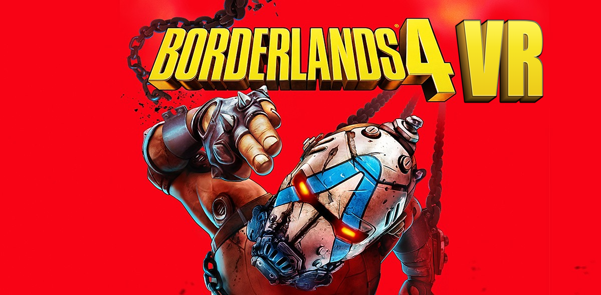

# Borderlands 4 – UEVR VR Profile

A full motion-controller VR conversion of Borderlands 4 for UEVR, with visible hands or IK arms, guns that shoot where you point them, two-handed aiming, weapon recoil from the game's own animations, body holsters, a hand-aimed grapple and a stable, comfortable camera. Special thanks to praydog, jbusfield (for his libs framework), and joeyhodge!

## IMPORTANT!

- My custom UEVR backend is required - see the releases on [letmein-vr/UEVR](https://github.com/letmein-vr/UEVR/releases) to download it. It carries the Borderlands 4 fixes this profile depends on: visible first-person arms and guns in stereo, working console variables, flicker-free menus, a usable map and inventory preview, and a working Ghosting Fix.
- Inject UEVR at the main menu.

## Features

### Hands and body

- **Two hand modes.** Pick **Hands** (glove hands cut from the game's own first-person arms) or **IK Arms** (full arms from your shoulders to the controllers, elbows solved in between). Switch live from the top of the Borderlands 4 panel.
- **Per-weapon hand poses.** The hands wrap around each weapon type with separate grip and trigger poses.
- **Game arms hidden.** The game's own first-person arms are hidden while your VR hands or arms hold the gun, so there is only ever one pair of hands.

### Weapons and combat

- **Weapon in hand.** The equipped weapon sits in your right hand (or on the IK hand) and aims where you point it, with per-weapon position and rotation offsets. Bullets leave the barrel of the gun you see thanks to a small native plugin (BL4AimFix.dll, source in `source/BL4AimFix`), which hooks the game's projectile spawn.
- **Projectile guns aim too.** Guns that fire real projectiles instead of instant bullets (e.g. the Vladof CrowdSourced sniper) also shoot down the barrel, with the game's own spread kept. Grenades and throwing knives are left to the throwing code.
- **Beam weapons aim too.** Beam guns (e.g. Maliwan beam SMGs) follow your hand as well: the plugin hands the game's beam aim the barrel of the gun you hold.
- **Game grip.** Weapons sit in your hand the way the game holds them, measured from the game's own arms, so new weapons need no per-weapon tuning (per-weapon offsets are still available).
- **Weapon animations kept.** Each first-person gun keeps its own animation, so slides, magazines and reloads still animate while it rides your hand.
- **Weapon recoil.** Every shot kicks the gun in your hand, taken from the game's own firing animation, so each weapon kicks the way it does in the flat game - back into your hand with muzzle flip, then recovering. Works in Hands and IK modes and while two-handing; distance and rotation strength are adjustable.
- **Two-handed aiming.** Bring your left hand to the gun's fore-grip and hold the left grip (or left trigger); the gun then pivots between both hands. The left hand glides on and off the gun and takes the game's own left-hand grip on that gun (hand position and fingers, measured per gun variant). In IK mode the whole left arm is solved onto the fore-grip.
- **The game's own crosshair, on your gun.** The game's real crosshair (each weapon's own reticle, spread and hit markers, in your crosshair colours) is shown at the point your barrel aims at, in 3D and at the right depth, and it is removed from the flat HUD so you only see it once. Only the crosshair moves: item cards, prompts and damage numbers near the screen centre stay on the HUD. It hides in menus and with no gun out. Needs a UEVR backend with the Borderlands 4 reticle layer (see Under the hood); on an older backend you get a plain dot reticule at the aim point instead, with adjustable colour, size and brightness.
- **PiP scopes.** Guns with a magnifying scope get a picture-in-picture scope while you aim down sights (left trigger). Every weapon variant works it out from its own parts: the lens sits at that scope's eyepiece, the picture uses the scope's in-game magnification and is centred where your shots go. Scope-less variants of the same gun get none. The lens position, size and tilt can be fine-tuned per scope model.
- **Clean ADS.** Aiming down sights no longer puts the game's flat-screen scope mask (a black square with a peephole) in front of your face, and scoped guns stay visible instead of vanishing.
- **Thrown ordnance.** Grenades and throwing knives are held in your left hand, in the game's own grip, and thrown with a real throwing motion.
- **Carried objects.** Tanks and other objects pulled in with the grapple ride your left hand and are thrown with a swing: the harder the swing, the further they fly.
- **Body holsters.** Press the right grip with your hand at a body spot to switch weapons: right hip, right shoulder, left shoulder, left hip (weapon slots 1-4). A short pulse tells you when your hand is in a holster zone.

### Movement

- **Hand-aimed grapple.** The grapple targets where your right hand (the gun's barrel, or the controller with no gun out) points, not where your head looks.
- **Head-directed movement.** Push forward and you walk where you're looking; the right stick still turns you.
- **Roomscale turning.** Turn your body and your character turns with you, so interaction prompts and the crosshair follow where you face.

### Vehicles

- **First person from the driver's seat.** The flat game only has a chase camera; in VR you sit at the driver's head, fixed to the vehicle, and look around freely with your head.
- **Stick steering.** The right stick steers, as in the flat game; your head only looks around.
- **Gaze-aimed vehicle guns.** The vehicle's guns fire where you look; the crosshair follows your head.
- **IK arms on the controls.** In IK Arms mode the driver's own arms are hidden and your IK arms grip the vehicle's controls, hands and fingers placed exactly where the game puts the driver's - no per-vehicle tuning.
- **No floating hands.** In Hands mode your VR hands are hidden while you drive; the driver's own hands stay on the controls.

### Camera and comfort

- **Steady camera.** Camera shakes (melee, shooting, hits), camera animations and the melee view sway are disabled.
- **Level view.** The game's hidden pitch is kept level, which stops recoil and full-auto fire from swinging the view or turning your character.
- **Decoupled pitch.** Looking up and down does not tilt the game camera; right stick up/down is ignored on foot with head aim.
- **Audio follows your head.** Sound is placed from your head, not from where your right hand points.
- **Full-screen effects off.** The game draws full-screen effects (repkit heal vignette, dash, burning, speed lines...) in the left eye only, so they are hidden; the effects themselves still happen.

### Menus and controls

- **Readable map and menus.** The map, inventory, skills and other ECHO menus are shown whole on a flat screen in both eyes while they're open, then the view returns to 3D. The main menu and the pause menu stay 3D.
- **X / B swap.** X and B are swapped by default, like my other profiles; switch it off at the top of the Borderlands 4 panel.

## Controls

| Action | Input |
|---|---|
| Move | Left stick, relative to where you look |
| Turn | Right stick |
| Aim / fire | Point the right controller, right trigger |
| Aim down sights / PiP scope | Left trigger |
| Two-hand a gun | Bring the left hand to the fore-grip, hold left grip |
| Switch weapon | Right grip at right hip / right shoulder / left shoulder / left hip |
| Grapple | Point the right hand at the grapple point |
| X / B | Swapped by default (Borderlands 4 panel → Swap X and B buttons) |
| Drive | Left stick throttle, right stick steers |
| Vehicle guns | Look at the target, fire |

## Installation

1. Install my custom UEVR (see above).
2. Import this profile in UEVR (or copy the files into `%APPDATA%\UnrealVRMod\Borderlands4`).
3. Start the game and inject UEVR at the main menu.

## Tuning

The **Borderlands 4** panel in the UEVR overlay is the only panel the profile shows. Its top has the everyday switches, in this order: hand mode (Hands / IK Arms), roomscale turning, aim method, X / B swap, two-handing on / off and its grab button, hand-aimed grapple, recoil (with distance and rotation strength) and recoil while two-handing. Below them, each feature has its own section:

- **Weapon Aim** – left / right and up / down trim of the gun's aim.
- **Reticule** – the game crosshair on / off, its size, crop and maximum distance, and which controller pose it follows; colour, size and brightness of the fallback dot.
- **Holsters** – on / off, haptic pulse, zone size and each zone's position, with a live readout of your hand's position.
- **Throwing** – throw tuning for grenades, knives and carried objects.

The finer tuning is in **Dev Config** at the bottom of the panel: weapon on the hand, the game's grip (with re-measure buttons), the camera options (shakes, animations, kick, level pitch, right stick pitch), hiding the full-screen effects, the game's left-hand grip, the hands / IK, two-handed and recoil details, **PiP Scope** (minimum magnification, per-scope lens offset / size / tilt, magnification trim, brightness) and **Vehicles** (seat view, what the view turns with, eye offset, IK arms on the controls, gaze-aimed guns). The ECHO menus on a flat screen, the hidden scope mask and the gun at world depth (needed for PiP scopes) are always on.

## Under the hood

Built on jbusfield's shared uevrlib Lua framework, running on my UEVR backend. Game-specific logic lives in small scripts on top of the framework: the weapon and hands bootstrap and camera handling (`bl4_main.lua`), the hands / IK mode switch (`bl4_vr_ik.lua`), two-handed aiming, recoil, holsters and the grapple aim.

Scopes: each sight part adds a sight behaviour with the game's zoom, and a scope part maps the gun's generic `ScopeSocket` to its own socket, so a PiP is built from the parts actually fitted (`bl4_vr_pip_scope.lua`, on jbusfield's `scope.lua`). The eyepiece comes from the scope's own mask mesh, or from the scope parts' bounds when it has none. The game's flat scope mask and vignette are hidden by `bl4_vr_scope.lua`, and BL4AimFix.dll clears the sight definition's "hide weapon when zoomed" flag. The picture only sorts correctly against the gun at real depth, so the gun, its parts and the VR hands / IK arms are always moved out of the game's foreground layer (the gun can poke into walls as a result).

Borderlands 4 draws the first-person arms and gun in its own foreground pass with a separate projection that the game only fills in its flat-screen path; the backend fills it from the VR projection, which is what makes the arms and gun visible in stereo. BL4 also has no player-side "equip weapon slot" function, so the holsters press the game's own number keys through `plugins/luakey.dll`, with a primer key first so the game accepts keyboard input while you're on a controller.

Vehicles (`bl4_vr_vehicle.lua`): while driving the aim method is Game, so the chase camera keeps following the right stick (BL4 vehicles steer toward it), and the VR view is moved from the chase camera to the driver's Head bone, held in the vehicle's frame. In IK Arms mode the driver's arm bones are hidden (render only - they keep animating), the IK rig is placed with its shoulders on the driver's, and each IK hand is pinned to the driver's hand bone with the inverse of the solver's controller-to-hand offset, so it lands exactly on the game's hand; the fingers copy the driver's grip. The 1P arms and 3P body share bone names and hand axes, which is why no per-vehicle values are needed. Vehicle guns are ordinary game weapons, so BL4AimFix.dll's projectile hook re-aims their shots along the HMD gaze.

Borderlands 4 draws its ECHO menus (map, inventory, skills) once across the whole two-eye render instead of once per eye, so each eye saw only one half. While a menu shows the cursor in game, `bl4_vr_menu_screen.lua` turns on the backend's 2D screen with the "full image in both eyes" option (`VR_2DScreenFullSource`, ported from Lorewright-Studios' UEVR fork). A backend without that option ignores it, and the menus then split between the eyes. The pause menu also shows the cursor but draws over the live world, which is fine in 3D, so it is left alone: only the ECHO menus stop the world view (`bPlayerViewRenderingSuspended` on the player controller), and that is what switches the flat screen on.

Game crosshair (`bl4_main.lua` + the backend's Borderlands 4 reticle layer): the crosshair is Coherent Prysm HTML drawn into the HUD, so it only exists on the flat UI layer. Drawn on a surface in the game world it goes through the game's tonemapper and comes out dark and washed out, so the backend does it in the compositor instead. The backend can't tell the crosshair from other HUD content near the centre (item cards, prompts, damage numbers), so while the layer is on the script switches the game's own crosshair colour settings to key colours no other HUD element uses. Each frame the backend moves only the key-coloured pixels of the UI image into its own small OpenXR quad layer, recoloured to your real crosshair colours, and leaves the rest of the HUD alone. Your real colours are kept in `data/bl4_crosshair_colors.txt` and put back whenever the layer is off. The layer is placed from the live controller pose and the muzzle offset the script measures, so it follows the gun without lag; only the hit distance comes from the game, from a trace along the barrel. Being a compositor layer like the HUD itself, it keeps the HUD's colours. The script turns the dot reticule off only once the backend confirms it has the layer. The backend part is Borderlands 4-only and not in a [letmein-vr/UEVR](https://github.com/letmein-vr/UEVR/releases) release yet.

Roomscale turning (`bl4_main.lua`): BL4 reverts plain control-rotation writes, so your body turn is applied with `ClientSetRotation`, which turns the camera, pawn and capsule together. The game's audio places its listener from the camera's cached view, so the grapple's hand aim is written into that view only for the duration of the grapple targeting call (inside BL4AimFix.dll), and the listener stays on your head.

The native plugin (BL4AimFix.dll) hooks the game's light-projectile spawn: player shots start at the muzzle of the first-person gun you see and fly along its barrel. Guns that fire actor projectiles (e.g. the Vladof CrowdSourced sniper) never reach that spawn, so the plugin also re-aims those in the engine's actor spawn (`UWorld::SpawnActor`): a projectile flies along its spawn rotation, so the spawn is moved to the muzzle and turned onto the barrel, keeping the game's spread. Only projectiles owned by a gun the player is holding are touched.

Full-screen effects (`bl4_vr_screen_effects.lua`): the game's screen effects are GPU Niagara sprites placed from the first view's camera, which in VR is the left eye, so the right eye looks past them. A GPU simulation can't follow both eyes from Lua, so they are not drawn in the main pass; they still run and finish on the game's schedule. Its source is in `source/BL4AimFix` (build paths in its CMakeLists.txt point at local folders and need adjusting).
